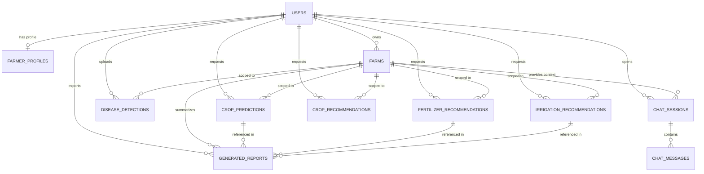

# TerraQora AI — Database Entity-Relationship Diagram

## Integrity & Authorization Rules
- Every user-owned domain row carries `user_id` (`NOT NULL`, `ON DELETE CASCADE`), enforced at API level so farmers can only read/export their own records (`admin` endpoints verify `role == 'admin'`).
- Check constraints enforce valid roles (`farmer | admin`), supported assistant languages (`en | ta | ml | hi | te`), non-negative agricultural quantities, valid `soil_ph` (`0..14`), and bounded probabilities (`0..1`).
- `irrigation_recommendations.is_sensor_backed` explicitly records `false` when recommendations derive from meteorological API estimates rather than physical soil probes.
