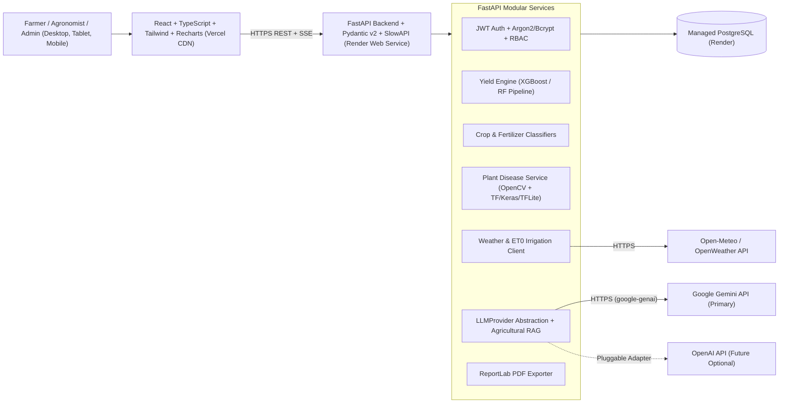

# TerraQora AI — System Architecture

## 1. High-Level Architecture Diagram

## 2. Technology Stack & Compatibility

| Layer | Technology | Purpose |
| --- | --- | --- |
| **Frontend** | React, TypeScript, Tailwind CSS, Lucide Icons, Recharts, Vite | 13 responsive SaaS pages, analytics charts, streaming AI chat UI |
| **Backend** | Python 3.13, FastAPI, Pydantic v2, SlowAPI, ReportLab | Typed REST APIs, SSE chat streaming, upload validation, PDF generation |
| **Database** | PostgreSQL 15+, SQLAlchemy 2.0, Alembic | 11 normalized relational tables, FK integrity, migrations |
| **ML / DL / CV** | Scikit-learn, XGBoost, TensorFlow/Keras, OpenCV | Leak-free regression, crop/fertilizer classification, leaf disease transfer learning |
| **GenAI** | `google-genai` (`gemini-2.5-flash`) + provider interface + local RAG | Grounded multilingual advice (`en`, `ta`, `ml`, `hi`, `te`) |
| **Hosting** | Vercel (Frontend) + Render (FastAPI + PostgreSQL) | Public HTTPS deployment |

## 3. Architectural Safeguards (Addressing Audit & Hosting Constraints)

1. **Leak-Free ML Pipelines:** `Production` is excluded from yield prediction inputs; all encoders and scalers sit inside unified `sklearn.pipeline.Pipeline` objects saved in `ml/saved_models/` so zero training/serving skew can occur.
2. **Memory-Aware Inference for Render (512 MB Free Tier):**
   - Replace the legacy `139.8 MB` unpruned Random Forest pickle with compact regularized `XGBoost` / depth-bounded tree artifacts (`< 15 MB`).
   - Train the PlantVillage CNN in **TensorFlow/Keras** and export both `.keras` (for local/GPU fidelity) and compact `.tflite` (quantized float16/int8, `< 10 MB`) so production API memory stays safely within Render's `512 MB` RAM limit without OOM crashes.
3. **LLM Provider Abstraction (`ai/chatbot/`):**
   - Abstract base class `LLMProvider` exposes `generate()` and `stream()` interfaces.
   - `GeminiProvider` uses the official `google-genai` SDK; `OpenAIProvider` implements the same contract for zero-friction future switching.
   - Grounded RAG retrieves verified crop/soil/IPM markdown chunks from `ai/rag/knowledge_base/` prior to generation and enforces uncertainty & expert-consultation guardrails.
4. **Security by Design:**
   - Zero secrets in repository (`.env` gitignored; `.env.example` placeholder-only).
   - Strict CORS allowlist, magic-byte + MIME + 5 MB size check on uploaded images, `bcrypt` password hashing, JWT access/refresh tokens, per-user resource authorization, and SlowAPI rate limiting.

## 4. Planned UI Pages (13 Pages)
1. Landing Page (`/`)
2. Login / Registration (`/auth`)
3. Farmer Dashboard (`/dashboard`)
4. Crop Yield Prediction (`/yield-prediction`)
5. Plant Disease Detection (`/disease-detection`)
6. Fertilizer Recommendation (`/fertilizer`)
7. Crop Recommendation (`/crop-recommendation`)
8. Weather & Irrigation (`/weather-irrigation`)
9. GenAI Farming Assistant (`/assistant`)
10. Agriculture Analytics (`/analytics`)
11. AI Reports (`/reports`)
12. User Profile (`/profile`)
13. Admin Dashboard (`/admin`)
