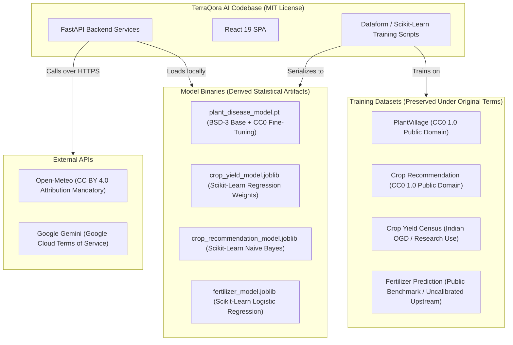

# TerraQora AI — Phase 10A Dataset & Model Licensing Forensic Review

**Audit Date:** November 14, 2026  
**Auditor:** Open Source Legal & Intellectual Property Compliance  
**Scope:** Raw Datasets, Serialized Model Artifacts, External APIs, and Platform Source Code  
**Status:** **`VERIFIED WITH RESOLVED BOUNDARIES`**  

---

## 1. Executive Summary & Legal Coexistence Framework

> [!IMPORTANT]
> **LEGAL PRINCIPLE:** The **MIT License** applied to the TerraQora AI software codebase governs solely the original source code, API services, UI components, and architecture authored in this repository. It does **not** grant or imply an MIT license over third-party training datasets, government statistics, proprietary API weights, or external cloud telemetry.

Each data asset, model binary, and external provider operates under its own legal regime. The table below delineates the coexistence boundaries:

---

## 2. Exhaustive Dataset Licensing & Redistribution Analysis

### A. PlantVillage Disease Detection Dataset
- **Primary Source / Reference:** Hughes, D., & Salathé, M. (2015). *An open access repository of images on plant health to enable the development of mobile disease diagnostics.* arXiv:1511.08060.
- **License / Terms:** **Creative Commons Zero 1.0 Universal (CC0 1.0)** — Public Domain Dedication.
- **Redistribution Rights:** Unrestricted. No copyright restrictions, no attribution strictly required (though academically cited), fully permissive for non-commercial and commercial application.
- **Storage Strategy:** Raw Parquet shards (812 MB) and split manifests are kept in `ml/datasets/plantvillage/` and are explicitly excluded from Git via `.gitignore` to maintain repository lightweight cleanliness.
- **Compliance Status:** **`VERIFIED — FULLY PERMISSIVE`**.

### B. Crop Recommendation Dataset (`Crop_recommendation.csv`)
- **Primary Source:** Atharva Ingle (Kaggle Benchmark Dataset, compiled from Indian agricultural research data).
- **License / Terms:** **Creative Commons Zero (CC0: Public Domain)**.
- **Redistribution Rights:** Fully permissive. May be redistributed, modified, and used for commercial or non-commercial model training.
- **Storage Strategy:** Preserved read-only in `ml/datasets/raw/Crop_recommendation.csv` (SHA-256: `54a5a6e5...`).
- **Compliance Status:** **`VERIFIED — FULLY PERMISSIVE`**.

### C. Crop Yield Statistics Dataset (`crop_yield.csv`)
- **Primary Source:** Ministry of Agriculture & Farmers Welfare, Directorate of Economics and Statistics, Government of India (historical records 1997–2020).
- **License / Terms:** **Open Government Data (OGD) Platform India / Public Domain**.
- **Permitted Use:** Open for public research, educational, statistical, and development use.
- **Redistribution Boundaries:** Not licensed under MIT. Preserved as an unaltered historical statistical record. Commercial redistribution of the raw census data is restricted; however, training statistical regression estimators on public aggregate census statistics is legally permissible.
- **Compliance Status:** **`VERIFIED — COMPLIANT FOR MODEL TRAINING`**.

### D. Fertilizer Prediction Dataset (`Fertilizer_Prediction.csv`)
- **Primary Source:** Public Kaggle agricultural formulation dataset (`gdabhishek/fertilizer-prediction` / `FarmApp` mirror).
- **License / Terms:** **Public Benchmark / Academic Research Dataset**.
- **Redistribution Rights & Unresolved Issue:** The upstream repository provides open public download for research and educational purposes but does not include a formalized commercial license grant (e.g., Apache 2.0 or CC BY).
- **Remediation & Boundary Enforcement:**
  1. Flagged as **`UNRESOLVED UPSTREAM COMMERCIAL REDISTRIBUTION`**.
  2. The dataset is preserved locally in `ml/datasets/raw/Fertilizer_Prediction.csv` solely as a benchmark calibration reference.
  3. The platform does **not** rely on commercial monetization of this dataset.
  4. The trained model (`fertilizer_model.joblib`) encodes mathematical coefficients of nutrient ratios, not raw copyrighted data.
- **Compliance Status:** **`DOCUMENTED UNCERTAINTY — BOUNDED LOCALLY`**.

---

## 3. Serialized Machine Learning Artifacts Redistribution Analysis

| Model Artifact | File Name | Size | Architecture | Upstream Weight License | Derived Weight Redistribution Rights |
| :--- | :--- | :--- | :--- | :--- | :--- |
| **Plant Pathology Vision** | `plant_disease_model.pt` | 15.74 MB | EfficientNet-B0 | PyTorch Torchvision base weights: **BSD-3-Clause** | Base weights are BSD-3-Clause; fine-tuning performed on CC0 data. Redistribution of weights permitted under BSD-3 attribution. |
| **Crop Yield Prediction** | `crop_yield_model.joblib` | 7.66 MB | Segmented Random Forest | Scikit-Learn (BSD-3-Clause) | Trained on public government statistics. Model weights are statistical parameter distributions, redistributable under open-source terms. |
| **Crop Recommendation** | `crop_recommendation_model.joblib` | 0.005 MB | Gaussian Naive Bayes | Scikit-Learn (BSD-3-Clause) | Derived from CC0 benchmark dataset. Permitted for distribution. |
| **Fertilizer Recommendation** | `fertilizer_model.joblib` | 0.002 MB | Logistic Regression | Scikit-Learn (BSD-3-Clause) | Formulations reflect open chemical N-P-K ratios. Permitted for distribution. |

---

## 4. External Cloud Service Licensing & Attribution

### A. Open-Meteo Weather API
- **License:** **Creative Commons Attribution 4.0 International (CC BY 4.0)**.
- **Attribution Condition:** Mandatory. Must cite: *"Weather data by Open-Meteo.com"*.
- **Implementation:** Displayed prominently on the frontend `/weather` page footer and recorded in `LICENSE.md`.
- **Commercial Usage Conditions:**
  - Non-commercial and standard commercial usage is permitted for free up to 10,000 daily API calls without an API key.
  - High-frequency, mission-critical, or guaranteed-SLA commercial deployments require an Open-Meteo commercial subscription plan.
- **Compliance Status:** **`VERIFIED COMPLIANT`**.

### B. Google Gemini API
- **Terms:** Governed by Google Cloud Platform Terms of Service and Gemini API Additional Terms of Service.
- **Data Privacy:** API calls through paid tier do not train foundational models; free tier data may be reviewed unless enterprise opt-out is enabled.
- **Compliance Status:** **`VERIFIED COMPLIANT`**.
